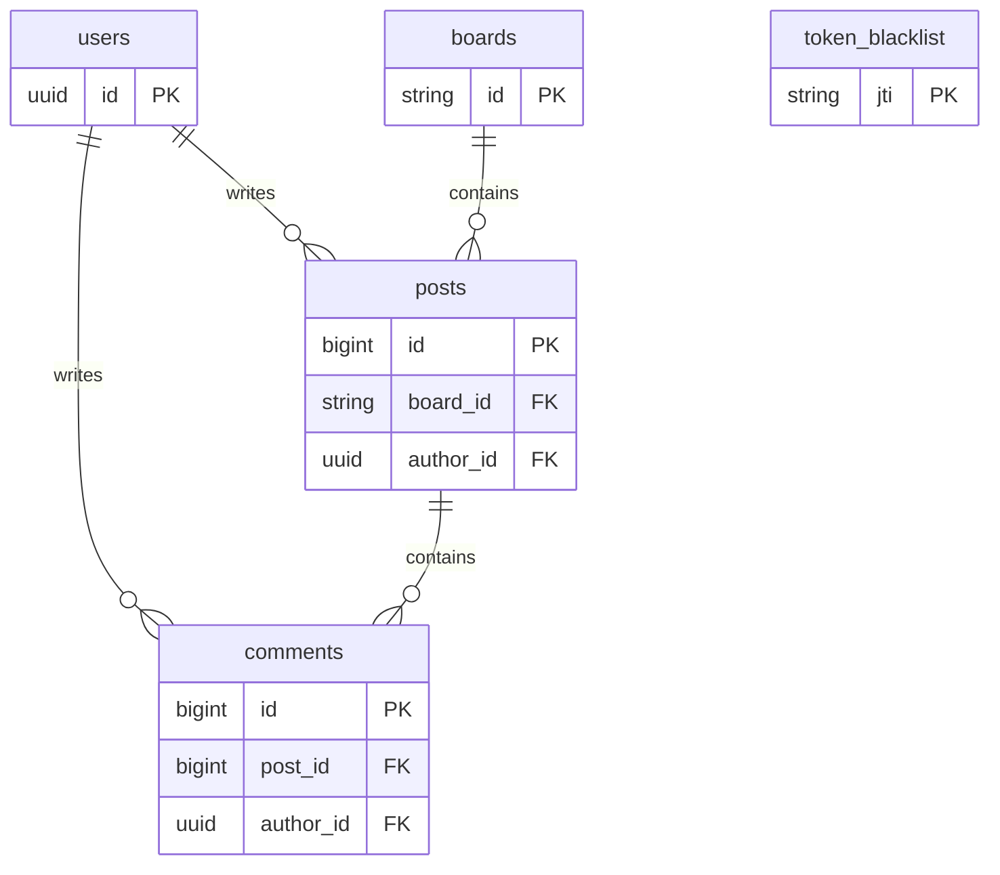

# Board API

유상진 개인 CH3 평가 과제. Premium Food API에서 회원·인증·게시판 기능만 분리한 REST API입니다.

## 1. 목적과 범위

게시글을 저장하는 것에서 끝나지 않고 **누가 작성했고, 누가 수정할 수 있는지**까지 검증합니다.
회원가입 → 로그인 → 글 작성 → 조회 → 수정 → 삭제가 핵심 흐름입니다.

- 포함: 회원가입, JWT 로그인·로그아웃, 게시판·게시글·댓글 CRUD, 작성자/관리자 권한, 검색·페이지 처리
- 제외: 상품, 주문, 재고, 쇼핑몰 화면. 별도 프론트엔드 없이 Swagger UI로 확인합니다.
- DB: PostgreSQL + SQLAlchemy / API: FastAPI + Pydantic / 인증: PyJWT + bcrypt

## 2. 4계층

| 계층 | 역할 | 예시 |
|---|---|---|
| Presentation | 요청을 받고 입력·응답 형식 검증 | `board/presentation/router.py` |
| Application | 기능의 순서와 권한·트랜잭션 조정 | `board/application/service.py` |
| Domain | 게시글 규칙과 저장소 인터페이스 | `board/domain/post.py` |
| Infrastructure | SQLAlchemy로 실제 DB 저장·조회 | `board/infrastructure/repositories.py` |

요청은 Router → Service → Repository 구현 → PostgreSQL로 처리됩니다.
Domain은 FastAPI·SQLAlchemy를 모릅니다. `wiring/`이 인터페이스와 구현을 연결합니다.

```text
src/
  main.py                 실행 진입점
  database.py             DB 연결과 요청별 세션
  user/                   회원 4계층
  auth/                   인증 4계층
  board/                  게시판 4계층
  shared/                 공통 오류·응답·트랜잭션
  wiring/                 의존성 연결
```

## 3. 데이터 관계



게시글·댓글은 작성자 외 수정·삭제를 제한합니다. 관리자에게는 관리 권한이 있습니다.
비밀번호는 해시로 저장하고, 만료·로그아웃된 토큰은 거절합니다. 기본 자유 게시판은 로그인 후 작성합니다.

## 4. 실행: Windows PowerShell

Python 3.13+, uv, PostgreSQL이 필요합니다. **기존 쇼핑몰 DB가 아닌 빈 `board_app` DB**를 준비하세요.

```powershell
uv sync --frozen
Copy-Item .env.example .env
uv run python -c "import secrets; print(secrets.token_urlsafe(64))"
```

마지막 명령의 임의 값을 `.env`의 `JWT_SECRET_KEY`에 저장합니다. 공유하거나 커밋하지 않습니다.
`DATABASE_URL`은 본인의 새 DB 계정으로 입력합니다. 첫 학습 실행에만 `CREATE_TABLES=true`, `DEMO_SEED=true`를 지정하면 테이블과 `free` 게시판이 생성됩니다. 이후 `CREATE_TABLES=false`, `DEMO_SEED=false`로 돌려놓습니다.

```powershell
$env:PYTHONPATH="src"
uv run uvicorn main:app --app-dir src --host 127.0.0.1 --port 8000
```

- Swagger: http://127.0.0.1:8000/docs
- 명세 원문: http://127.0.0.1:8000/openapi.json
- 상태 확인: http://127.0.0.1:8000/health

`/health`는 프로세스 확인용입니다. DB 연결 정상 여부를 보장하지 않습니다.

## 5. 시연 순서

1. `POST /v1/users`: 서로 다른 회원 A, B 가입
2. Swagger **Authorize**: username에 A의 이메일, password에 비밀번호 입력
3. `POST /v1/boards/free/posts`: 제목·내용 등록 (201)
4. 목록 및 상세 조회 (200)
5. 작성자 A로 수정 (200)
6. 회원 B로 인증 후 같은 글 수정·삭제 요청 (403)
7. A로 다시 인증한 뒤 삭제 (204), 이후 조회 거절 확인
8. 댓글 CRUD 및 로그아웃 후 토큰 거절 확인

Swagger의 각 요청 스키마와 상태코드는 [API 명세](docs/API_SPEC.md)를 참고합니다.
캡처에는 비밀번호·토큰·실제 연락처를 노출하지 않습니다.

## 6. 검증

```powershell
$env:TEST_DATABASE_URL="postgresql+asyncpg://<테스트계정>:<비밀번호>@127.0.0.1:5432/board_test"
uv run pytest -q
uv run ruff check src tests scripts
```

테스트는 **localhost의 `board_test` 전용 DB만 허용**하며, 테스트별 변경을 롤백합니다. 다른 업무 데이터가 없는 계정·DB를 사용하세요.
현재 검증 범위와 미완료 항목은 [검증 기록](docs/VERIFICATION.md)을 확인합니다. 과거 쇼핑몰의 테스트 통과 수는 이 분리본의 결과가 아닙니다.

## 7. 제출 상태

- [x] 쇼핑몰 기능을 제외한 별도 게시판 코드
- [x] 4계층·JWT·SQLAlchemy·Swagger 구성
- [x] 정적 검사 및 DB 없는 검증
- [ ] PostgreSQL 통합 테스트와 실제 CRUD 재검증
- [ ] 실제 시연 캡처 첨부
- [ ] 개인 공개 GitHub URL 확인
- [ ] AWS EC2 배포 URL/IP와 외부 Swagger 접속 확인
- [ ] LMS GitHub URL + 배포 URL 제출

**EC2 배포 주소는 아직 없습니다. localhost는 제출용 배포 주소가 아닙니다.**

## 8. 기반 코드

- [Premium Food API](https://github.com/yoosangjn-stack/premium-food-api), 기준 커밋 `38c3c50e1a059788db824630e8b01599e891db32`
- [강의 게시판 프로젝트](https://github.com/yonggyo1125/backend_project_ax1)

분리 과정에서는 회원·인증·게시판 구조를 유지하고 상품·주문·템플릿·정적 UI를 제거했습니다.
